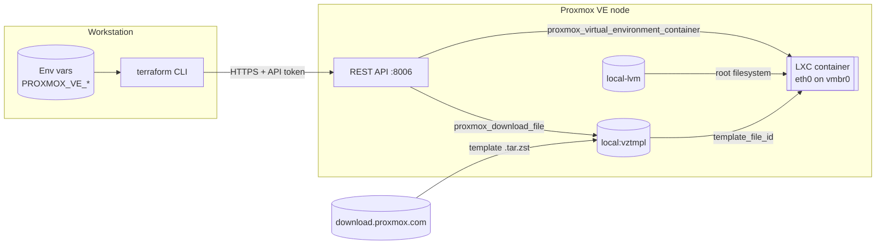
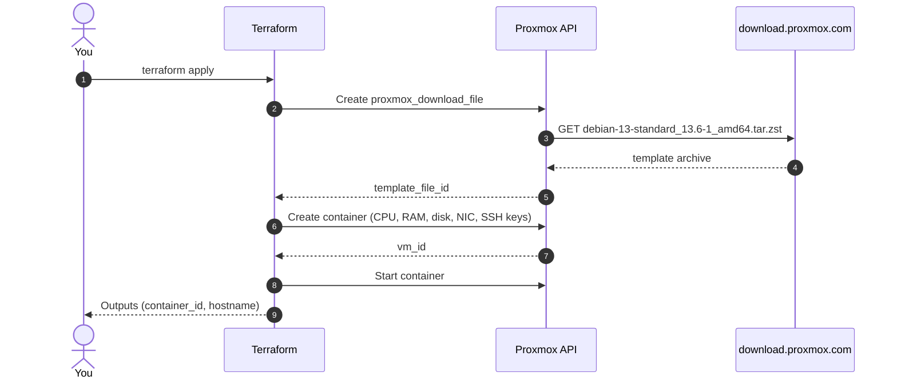

<div align="center">

# 🏗️ Terraform × Proxmox

### *An effort to create a VM with Terraform*

**Declarative, repeatable, version-controlled guests on Proxmox VE.**

[](https://developer.hashicorp.com/terraform)
[](https://registry.terraform.io/providers/bpg/proxmox/latest)
[](https://www.proxmox.com/)
[](https://www.debian.org/)
[](#-roadmap)

[Overview](#-overview) •
[Architecture](#-architecture) •
[Quick Start](#-quick-start) •
[Configuration](#-configuration-reference) •
[Security](#-security) •
[Roadmap](#-roadmap) •
[FAQ](#-faq)

</div>

---

## 📖 Table of Contents

1. [Overview](#-overview)
2. [A Note on "VM" vs. "Container"](#-a-note-on-vm-vs-container)
3. [Features](#-features)
4. [Architecture](#-architecture)
5. [Repository Layout](#-repository-layout)
6. [Prerequisites](#-prerequisites)
7. [Quick Start](#-quick-start)
8. [Configuration Reference](#-configuration-reference)
9. [Outputs](#-outputs)
10. [Usage Recipes](#-usage-recipes)
11. [Security](#-security)
12. [Troubleshooting](#-troubleshooting)
13. [Roadmap](#-roadmap)
14. [FAQ](#-faq)
15. [Contributing](#-contributing)
16. [Acknowledgements](#-acknowledgements)

---

## 🔭 Overview

This repository is an **effort to create a virtual machine using Terraform**. It is
Infrastructure as Code (IaC) for a [Proxmox VE](https://www.proxmox.com/en/proxmox-virtual-environment/overview)
homelab. A single `terraform apply` does two things:

1. **Downloads** a Debian 13 template to the node's `local` storage.
2. **Creates and starts** a guest from that template, with CPU, memory, disk, network,
   hostname, DNS and SSH access all defined in code.

> **Why Terraform?**
> Clicking through a web UI is fast once and unreliable forever after. Code is
> reviewable, diffable, repeatable and *destroyable*.

The project is deliberately small. It is meant to be **read in one sitting**, understood
completely, and then extended.

---

## ⚠️ A Note on "VM" vs. "Container"

> [!NOTE]
> The goal of this repo is "a VM with Terraform", but the code currently provisions an
> **LXC container**, using the `proxmox_virtual_environment_container` resource.
> Containers share the host kernel and start in seconds. Full VMs use the
> `proxmox_virtual_environment_vm` resource.

| Aspect | LXC container *(this repo today)* | QEMU/KVM VM *(roadmap)* |
| :----- | :-------------------------------: | :---------------------: |
| Kernel | Shared with host | Own kernel |
| Boot time | ~seconds | ~tens of seconds |
| Overhead | Very low | Moderate |
| Isolation | Namespaces / cgroups | Hardware virtualization |
| Resource | `proxmox_virtual_environment_container` | `proxmox_virtual_environment_vm` |
| Status | ✅ Implemented | 🚧 Planned |

---

## ✨ Features

- **Fully declarative.** Every setting is a typed, documented variable.
- **Automatic template download.** It uses `proxmox_download_file`, so there is no manual `pveam` step.
- **Flexible networking.**
  - IPv4: static CIDR or `dhcp`
  - IPv6: static, `dhcp`, or `auto` (SLAAC)
  - Optional VLAN tagging
  - Optional custom DNS servers
- **Secure by default.**
  - Unprivileged container
  - SSH key authentication
  - TLS verification on (`insecure = false`)
  - Credentials via environment variables only
  - Root password marked `sensitive`
- **Sensible defaults.** Only `node_name` and `ssh_public_keys` are required.
- ~~Manual clicking in the web UI~~ Reproducible infrastructure.

---

## 🧩 Architecture

### Resource graph



### Apply sequence



### Resources managed

| Resource | Type | Purpose |
| :------- | :--- | :------ |
| `proxmox_download_file.template` | `bpg/proxmox` | Fetches the LXC template into `local:vztmpl` |
| `proxmox_virtual_environment_container.this` | `bpg/proxmox` | Creates and starts the container |

---

## 📁 Repository Layout

```text
.
├── main.tf                    # Resources: template download + container
├── variables.tf               # Typed input variables with descriptions
├── outputs.tf                 # container_id, hostname
├── versions.tf                # Terraform / provider constraints + provider block
├── terraform.tfvars.example   # Copy to terraform.tfvars and edit
├── .terraform.lock.hcl        # Provider checksums (commit this)
├── terraform.tfvars           # Your local values (do not commit)
└── README.md                  # You are here
```

---

## 🧰 Prerequisites

| Requirement | Version | Notes |
| :---------- | :------ | :---- |
| [Terraform](https://developer.hashicorp.com/terraform/install) | `>= 1.9.0` | Or [OpenTofu](https://opentofu.org/), untested |
| Proxmox VE | 8.x | Reachable over HTTPS with a valid certificate |
| Proxmox API token | n/a | Needs rights to create containers and download files |
| SSH agent | n/a | The provider uses `ssh { agent = true }` for operations the API cannot do |
| SSH key pair | n/a | The public key goes in `ssh_public_keys` |

### Required Proxmox permissions

The API token needs, at minimum, permission to:

- [x] Allocate guests (`VM.Allocate`)
- [x] Configure guest hardware (`VM.Config.*`)
- [x] Use storage (`Datastore.AllocateSpace`, `Datastore.AllocateTemplate`)
- [x] Use the network bridge (`SDN.Use`)
- [ ] Anything else. Keep it least-privilege.

---

## 🚀 Quick Start

### 1. Clone the repository

```bash
git clone https://github.com/okrumm/Terraform.git
cd Terraform
```

### 2. Export credentials

```bash
export PROXMOX_VE_ENDPOINT="https://pve.example.com:8006/"
export PROXMOX_VE_API_TOKEN="user@pam!tokenid=xxxxxxxx-xxxx-xxxx-xxxx-xxxxxxxxxxxx"

# Optional: console login for root. Omit for SSH-key-only access.
export TF_VAR_root_password="$(openssl rand -base64 24)"
```

> [!WARNING]
> Never write the API token or root password into a `.tf` or `.tfvars` file.

### 3. Create your variables file

```bash
cp terraform.tfvars.example terraform.tfvars
$EDITOR terraform.tfvars
```

```hcl
node_name = "pve"
hostname  = "ct-demo"

bridge       = "vmbr0"
vlan_id      = 17
ipv4_address = "dhcp"
ipv6_address = "auto" # SLAAC

ssh_public_keys = [
  "ssh-ed25519 AAAA... user@host",
]
```

### 4. Initialize, plan, apply

```bash
terraform init      # download the bpg/proxmox provider
terraform validate  # static checks
terraform plan      # preview changes
terraform apply     # create the guest
```

### 5. Connect

```console
$ terraform output
container_id = 105
hostname     = "ct-demo"

$ ssh root@ct-demo
root@ct-demo:~#
```

### 6. Tear down

```bash
terraform destroy
```

---

## ⚙️ Configuration Reference

### Required inputs

| Name | Type | Description |
| :--- | :--- | :---------- |
| `node_name` | `string` | Proxmox node that hosts the container |
| `ssh_public_keys` | `list(string)` | SSH public keys authorized for `root` |

### Identity

| Name | Type | Default | Description |
| :--- | :--- | :------ | :---------- |
| `container_id` | `number` | `null` | Numeric CT ID. `null` lets Proxmox pick the next free ID |
| `hostname` | `string` | `"ct-terraform"` | Container hostname |
| `description` | `string` | `"Managed by Terraform"` | Free-text description |
| `tags` | `list(string)` | `["terraform"]` | Tags shown in the Proxmox UI |

### Template and OS

| Name | Type | Default | Description |
| :--- | :--- | :------ | :---------- |
| `template_url` | `string` | `https://download.proxmox.com/images/system/debian-13-standard_13.6-1_amd64.tar.zst` | HTTPS URL of the template |
| `template_file_name` | `string` | `debian-13-standard_13.6-1_amd64.tar.zst` | File name in `local:vztmpl` |
| `os_type` | `string` | `"debian"` | Guest OS type (`debian`, `ubuntu`, `alpine`, ...) |

### Compute and storage

| Name | Type | Default | Description |
| :--- | :--- | :------ | :---------- |
| `cpu_cores` | `number` | `1` | Number of vCPU cores |
| `memory_mb` | `number` | `512` | Dedicated memory in MB |
| `swap_mb` | `number` | `512` | Swap in MB |
| `disk_datastore_id` | `string` | `"local-lvm"` | Datastore for the root filesystem |
| `disk_size_gb` | `number` | `8` | Root filesystem size in GB |

### Networking

| Name | Type | Default | Description |
| :--- | :--- | :------ | :---------- |
| `bridge` | `string` | `"vmbr0"` | Network bridge |
| `vlan_id` | `number` | `null` | VLAN tag. `null` means untagged |
| `ipv4_address` | `string` | `"dhcp"` | CIDR such as `192.168.1.50/24`, or `dhcp` |
| `ipv4_gateway` | `string` | `null` | Required for static IPv4. Must be `null` for `dhcp` |
| `ipv6_address` | `string` | `"auto"` | CIDR, `dhcp`, or `auto` (SLAAC) |
| `ipv6_gateway` | `string` | `null` | Must be `null` for `dhcp` and `auto` |
| `dns_servers` | `list(string)` | `[]` | Custom DNS servers. Empty uses the host's settings |

### Behaviour and access

| Name | Type | Default | Description |
| :--- | :--- | :------ | :---------- |
| `unprivileged` | `bool` | `true` | Run unprivileged (**recommended**) |
| `start_on_boot` | `bool` | `true` | Start when the node boots |
| `root_password` | `string` 🔒 | `null` | `sensitive`. Supply via `TF_VAR_root_password` |

<details>
<summary><strong>🔍 Click to expand: design notes on a few settings</strong></summary>

<br>

- **`features { nesting = true }`.** Debian 13 ships systemd 257, which needs nesting
  for getty and credentials setup inside LXC. Without it, the console may not come up.
- **`dynamic "dns"`.** The `dns` block is only rendered when `dns_servers` is non-empty.
  Otherwise the container inherits the host's resolver.
- **`started = true`.** The container is started right after creation.
- **`insecure = false`.** TLS certificate validation is never disabled.

</details>

---

## 📤 Outputs

| Output | Description |
| :----- | :---------- |
| `container_id` | ID of the created container (`vm_id`) |
| `hostname` | Container hostname |

---

## 🍳 Usage Recipes

### Static IPv4 with custom DNS

```hcl
ipv4_address = "192.168.1.50/24"
ipv4_gateway = "192.168.1.1"
ipv6_address = "auto"
dns_servers  = ["1.1.1.1", "9.9.9.9"]
```

### A beefier guest

```hcl
cpu_cores    = 4
memory_mb    = 4096
swap_mb      = 1024
disk_size_gb = 32
```

### Pin the container ID

```hcl
container_id = 250
```

### Pass variables on the command line

```bash
terraform apply \
  -var 'node_name=pve' \
  -var 'hostname=ct-web' \
  -var 'ssh_public_keys=["ssh-ed25519 AAAA... me@laptop"]'
```

### Useful commands

| Command | Purpose |
| :------ | :------ |
| `terraform fmt -recursive` | Format all `.tf` files |
| `terraform validate` | Validate the configuration |
| `terraform plan -out=tfplan` | Save a plan |
| `terraform show` | Inspect current state |
| `terraform state list` | List tracked resources |
| `terraform apply -replace=proxmox_virtual_environment_container.this` | Force-recreate the container |
| `terraform destroy` | Remove everything created here |

---

## 🔐 Security

> **Principle:** secrets live in the environment or a vault. They never live in Git.

### What this repo already does

- ✅ TLS verification enabled (`insecure = false`)
- ✅ API credentials read from `PROXMOX_VE_*` environment variables
- ✅ `root_password` is `sensitive` and intended for `TF_VAR_root_password`
- ✅ Unprivileged container by default
- ✅ SSH key authentication

### Keep these out of version control

| File | Why |
| :--- | :-- |
| `terraform.tfstate`, `*.tfstate.backup` | State can contain **secrets in plaintext**, such as the root password |
| `terraform.tfvars` | May contain environment-specific values |
| `.terraform/` | Provider binaries (large, reproducible via `terraform init`) |

> [!CAUTION]
> Terraform state is **not** encrypted by default. Use a remote backend with encryption
> and locking for anything beyond a personal lab. Examples are S3 with KMS, Terraform
> Cloud, or an encrypted GitLab/MinIO backend.

This repository does not yet ship a `.gitignore`. Add one covering these paths. In this
repo, the state files, `terraform.tfvars` and `.terraform/` are currently tracked by Git,
and files stay tracked until you remove them from the index:

```bash
git rm --cached terraform.tfstate terraform.tfstate.backup terraform.tfvars
git rm -r --cached .terraform
git commit -m "Stop tracking state, variables and provider binaries"
```

If a secret was ever committed, **rotate it**. Removing it from the latest commit does
not remove it from history.

---

## 🩺 Troubleshooting

| Symptom | Likely cause | Fix |
| :------ | :----------- | :-- |
| `x509: certificate signed by unknown authority` | The node uses a self-signed certificate | Install a trusted certificate on the node (e.g. ACME). Do **not** set `insecure = true` |
| `401 Unauthorized` | Bad or expired API token | Re-check `PROXMOX_VE_API_TOKEN` format: `user@realm!tokenid=secret` |
| `403 Permission check failed` | Token lacks privileges | Grant the role on `/` or on the needed paths. Check *Privilege Separation* |
| Template download fails | Storage full or URL changed | Check `local` free space; verify `template_url` |
| `ssh: handshake failed` | SSH agent not running | `eval $(ssh-agent) && ssh-add` |
| Console shows no login prompt | Missing nesting | Keep `features { nesting = true }` for Debian 13 |
| Plan wants to replace the container every time | Changed template or disk settings | Review the `forces replacement` markers in the plan |

Enable verbose provider logging when in doubt:

```bash
TF_LOG=DEBUG terraform plan 2> debug.log
```

---

## 🗺️ Roadmap

- [x] Download LXC template automatically
- [x] Create and start an unprivileged Debian 13 container
- [x] Configurable CPU, memory, swap and disk
- [x] IPv4 / IPv6 / VLAN / DNS support
- [x] SSH key injection
- [ ] Add a **QEMU/KVM VM** module (`proxmox_virtual_environment_vm`) with cloud-init
- [ ] Support multiple guests via `for_each`
- [ ] Remote, encrypted state backend
- [ ] Input validation blocks (CIDR format, gateway rules)
- [ ] Extra outputs (IP address, console URL)
- [ ] CI pipeline: `fmt`, `validate`, `tflint`, `checkov`
- [ ] Post-provision configuration with Ansible

---

## ❓ FAQ

**Is this a VM or a container?**
Today it is an LXC container. See [the note above](#-a-note-on-vm-vs-container). A full
VM module is on the [roadmap](#-roadmap).

**Can I use another distribution?**
Yes. Change `template_url`, `template_file_name` and `os_type`.

**Why does Terraform need an SSH agent?**
Some Proxmox operations cannot be done through the REST API. The `bpg/proxmox`
provider falls back to SSH for those[^1].

**Does this work on Proxmox 7?**
It is untested. Proxmox VE 8 is the target.

**Can I run this with OpenTofu?**
Probably, because the provider is compatible. It has not been verified here.

[^1]: See the [provider documentation](https://registry.terraform.io/providers/bpg/proxmox/latest/docs#authentication) for details on API versus SSH operations.

---

## 🤝 Contributing

Contributions are welcome.

1. **Fork** the repository
2. **Create** a branch: `git checkout -b feature/my-improvement`
3. **Format and validate**:
   ```bash
   terraform fmt -recursive
   terraform validate
   ```
4. **Commit** with a clear message
5. **Open** a pull request

### Style guide

- Every variable has a `description` and a `type`
- Secrets are always `sensitive = true`
- Prefer small, composable changes
- Comments explain *why*, not *what*

---

## 🙏 Acknowledgements

- [**bpg/terraform-provider-proxmox**](https://github.com/bpg/terraform-provider-proxmox): the provider that makes this possible
- [**HashiCorp Terraform**](https://www.terraform.io/): the engine
- [**Proxmox VE**](https://www.proxmox.com/): the hypervisor
- [**Debian**](https://www.debian.org/): the guest OS

---

<div align="center">

**Built with ☕, `terraform apply`, and a healthy fear of clicking things twice.**

*Infrastructure should be boring, so write it down.*

[⬆ Back to top](#-terraform--proxmox)

</div>
